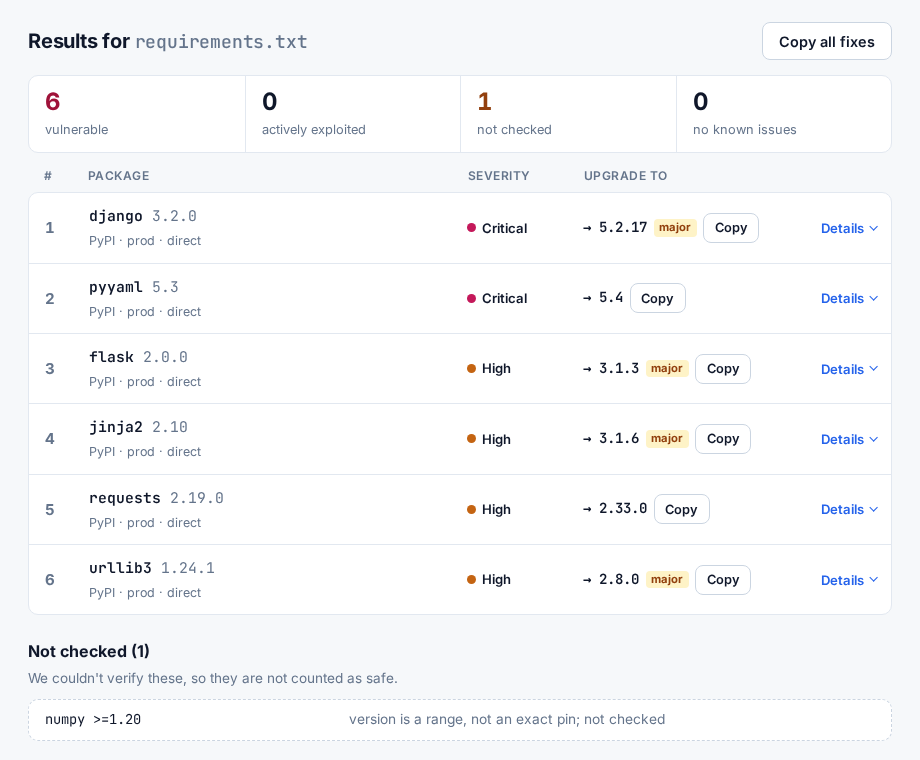

<p align="center">
  
</p>

<h1 align="center">Dependency Compass</h1>

<p align="center">
  <b>Find which vulnerable dependencies to fix first.</b><br>
  <a href="https://dependency-compass.onrender.com">Live demo</a> ·
  <a href="docs/ranking.md">How ranking works</a> ·
  <a href="docs/security.md">Security design</a>
</p>

<p align="center">
  <a href="https://github.com/hal-imaxabdi/Dependency-compass/actions/workflows/ci.yml"></a>
  <a href="LICENSE"></a>
</p>

Drop in a `package-lock.json` or `requirements.txt` and get a ranked fix list:

- **Actively exploited first** ([CISA KEV](https://www.cisa.gov/known-exploited-vulnerabilities-catalog)), then by severity
- **One upgrade per package** that fixes every advisory it can
- **Nothing silently skipped:** what it couldn't check is listed, never reported as safe



## Use it

**In the browser:** open the [live demo](https://dependency-compass.onrender.com).
Files are scanned in memory and never stored. The free server can take ~30 s
to wake up.

**In GitHub Actions:** fails the build on actively exploited or high-severity
vulnerabilities.

```yaml
- uses: hal-imaxabdi/Dependency-compass@27f92da2bf5c8274e278ad114d976815f20ec256 # v0.1.0
  with:
    file: package-lock.json   # or requirements.txt
    fail-on: high             # critical | high | medium | low | any
    strict: "false"           # "true" also fails when something couldn't be checked
```

**From the command line:**

```bash
pip install "git+https://github.com/hal-imaxabdi/Dependency-compass@v0.1.0"
dependency-compass scan package-lock.json
dependency-compass scan requirements.txt --json > report.json
```

Exit codes: `0` nothing to fix · `1` something to fix · `2` bad input ·
`3` vulnerability database unreachable · `4` some things couldn't be checked.

> **Tip:** scan `package-lock.json` rather than `package.json`. Only the
> lockfile has exact versions; ranges like `^4.1.0` can't be checked.

## Learn more

- [How ranking works](docs/ranking.md): the rules, the upgrade target, limitations
- [Security design](docs/security.md): how untrusted files and feeds are handled
- [Development](docs/development.md): run it locally and contribute

Data from [OSV.dev](https://osv.dev) and CISA KEV.
