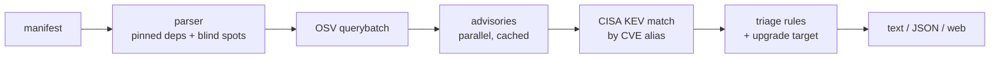

# Dependency Compass

[](https://github.com/hal-imaxabdi/Dependency-compass/actions/workflows/ci.yml)

**Live demo: https://dependency-compass.onrender.com** (free tier: the first request after a quiet period can take ~30–60 s while the server wakes up)

A dependency vulnerability triage tool. Most scanners give you a flat list of
alerts. Dependency Compass answers three questions instead:

1. **What should I fix first?** Findings are ranked by documented rules:
   actively exploited (CISA KEV) first, then severity, production vs dev, and
   direct vs transitive.
2. **Why does it rank there?** Every finding lists its reasons, plus one
   concrete upgrade target that fixes everything that can be fixed.
3. **What couldn't you check?** Anything it couldn't verify (unpinned
   versions, unsupported lines, an unreachable KEV catalog) is reported as a
   *blind spot*. It never reports "clean" when it couldn't check.


## Use it

**Web:** upload or paste a `requirements*.txt`, `package.json` or
`package-lock.json`, or click **Load sample**.

**CLI**

```bash
python -m venv .venv && source .venv/bin/activate
pip install -r requirements.txt && pip install --no-deps .
dependency-compass scan package-lock.json            # readable report
dependency-compass scan requirements.txt --json      # machine-readable
dependency-compass scan requirements.txt --fail-on critical --strict
```

**GitHub Action**

```yaml
- uses: hal-imaxabdi/Dependency-compass@<commit-sha>   # pin to a commit, not a branch
  with:
    file: package-lock.json
    fail-on: high      # critical | high | medium | low | any
    strict: "false"    # "true" also fails when anything couldn't be checked
```

### Exit codes (CLI and Action)

| Code | Meaning |
|---|---|
| 0 | Everything checkable was checked; nothing reached the threshold |
| 1 | A finding is in CISA KEV, or at/above `--fail-on` (default `high`) |
| 2 | Usage error, or the file is unreadable, too large, not UTF-8 or unsupported |
| 3 | OSV unreachable: no report at all (fail closed) |
| 4 | Incomplete: KEV unavailable while there were findings, or `--strict` with blind spots |

## Triage rules

Findings are compared rule by rule. A later rule only breaks ties left by the
earlier ones, so every ordering can be explained. A package with several
advisories ranks by its worst one.

1. **Known exploited:** any advisory in the CISA KEV catalog ranks first.
2. **Severity:** critical > high > *unknown* > medium > low. Unknown sits above
   medium on purpose, because missing data shouldn't make something look safer.
3. **Production before dev.** Lockfiles say which. For requirements files it's
   inferred from the name (`requirements-dev.txt`, `test-requirements.txt`) and
   labelled "assumed".
4. **Direct before transitive:** a direct dependency is one you can upgrade yourself.
5. **Fix availability:** every advisory fixed > only some (partial) > none.
6. **Tie-break** by name and version, so output is deterministic.

**Upgrade target:** the smallest fixed version newer than yours that falls
outside *every* advisory's affected range. Ranges are compared with PEP 440
(PyPI) or SemVer (npm) rules. If any range can't be compared safely, no target
is shown, because a wrong "upgrade to X" is worse than none. Major-version jumps
are flagged.

## How it works



Python 3.12, FastAPI, httpx; no database. Data sources:
[OSV.dev](https://osv.dev) and the
[CISA KEV catalog](https://www.cisa.gov/known-exploited-vulnerabilities-catalog).

## Security decisions

The tool parses files from strangers and data from third-party feeds, so
everything is treated as untrusted.

- **Fail closed.** Any OSV error aborts the scan: there are no partial results
  that look complete. If KEV is unreachable, the scan still runs, but every
  finding's KEV status is `unknown` (never `false`) and a blind spot says so.
- **Uploads are never stored.** The API takes the raw body and reads it into
  memory in chunks, capped at 1 MB. It's deliberately not multipart, because
  Starlette spools large multipart uploads to temp files on disk.
- **Input limits everywhere:** body size, line length, dependency count,
  JSON nesting, advisory count per scan, KEV catalog size and entry count,
  version string length.
- **No path echo.** Only the file's base name is used or shown.
- **Output sanitizing.** Package names and advisory text have control
  characters, ANSI escapes and bidi overrides stripped and are truncated, so a
  malicious lockfile can't rewrite your terminal. The web page builds the DOM
  with `textContent` only (a test forbids `innerHTML`/`eval`).
- **Strict CSP**, no inline scripts, no third-party scripts, fonts or trackers.
  The API sends `default-src 'none'`, `no-store` and `nosniff`.
- **Safe errors.** Every error is a fixed `{"error": "..."}` message, with no
  stack traces or exception text. Details are logged server-side only.
- **Rate limiting** per client and globally (protects OSV/KEV from abuse via
  this app). The client IP comes from `X-Forwarded-For` only at a *measured*
  proxy depth. On Render the chain is `client, Cloudflare, internal`, so the
  client is the 3rd entry from the right, and spoofed entries added on the left
  are ignored. If the header looks wrong, it falls back to a shared bucket
  (stricter, never looser).
- **Network hygiene:** explicit timeouts, retries only on transient errors with
  backoff, OSV IDs checked against an allow-list before use in URLs.
- **Supply chain:** exact version pins, GitHub Actions pinned to full commit
  SHAs (a test enforces this), least-privilege CI tokens, and Action inputs
  passed via `env` to prevent shell injection.

## Limitations

- **Formats:** `requirements*.txt`, `package.json` and `package-lock.json` (v1–v3)
  only. No Poetry, Pipenv, yarn or pnpm lockfiles yet.
- **Only exact pins are checked.** Ranges (`>=2.0`, `^4.1.0`) are blind spots,
  so `package.json` alone usually checks nothing. Scan the lockfile instead.
- **requirements.txt has no dependency tree:** everything is treated as direct,
  and dev/prod is inferred from the file name. `-r` includes aren't followed.
- **No reachability analysis:** it doesn't know whether your code calls the
  vulnerable function.
- **Severity** comes from the advisory's database label (GitHub's); CVSS
  isn't recomputed. Few library CVEs are in KEV, because KEV mostly tracks
  products.
- **Upgrade targets** don't check API compatibility beyond flagging major bumps,
  or whether a version was yanked.
- **Single instance:** rate limits and caches are in memory and reset on
  restart; the first scan after a restart refetches advisories (~8 s for the
  sample).

## Development

```bash
python -m venv .venv && source .venv/bin/activate
pip install -r requirements-dev.txt
python -m pytest -q                                   # no test touches the real network
uvicorn --factory dependency_compass.api:app_from_env --port 8000
```

Configuration (environment variables): `DC_PROXY_HOPS` (trusted proxy depth,
default 0), `DC_ENABLE_DOCS=1` (OpenAPI docs, off by default),
`DC_LOG_FORWARDED=1` (log the raw forwarded header to re-measure the proxy chain).
Deployment is defined in [`render.yaml`](render.yaml).
