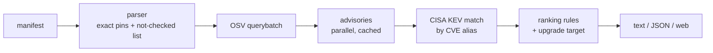

# Development

```bash
git clone https://github.com/hal-imaxabdi/Dependency-compass.git
cd Dependency-compass
python -m venv .venv && source .venv/bin/activate
pip install -r requirements-dev.txt
python -m pytest -q        # no test touches the real network
uvicorn --factory dependency_compass.api:app_from_env --port 8000
```

Then open http://localhost:8000.

## How it works



| Module | Job |
|---|---|
| `parsers/` | requirements.txt, package.json, package-lock.json (v1–v3), composer.lock |
| `osv_client.py` | OSV batch queries, pagination, retries, validation |
| `advisory.py`, `advisory_cache.py` | parse OSV records; in-memory TTL cache |
| `kev.py` | CISA KEV download, validation, cache, stale fallback |
| `scanner.py` | the pipeline; fails closed |
| `triage.py`, `upgrade.py`, `versions.py` | ranking rules and upgrade targets |
| `report.py`, `cli.py` | text/JSON output and exit codes |
| `api.py`, `ratelimit.py`, `static/` | web API and page |

## Configuration

| Variable | Default | Meaning |
|---|---|---|
| `DC_PROXY_HOPS` | `0` | Trusted proxy depth for client IPs (Render: `3`) |
| `DC_ENABLE_DOCS` | off | `1` serves OpenAPI docs at `/docs` |
| `DC_LOG_FORWARDED` | off | `1` logs the raw `X-Forwarded-For`, to re-measure the proxy chain |

Deployment is defined in [`render.yaml`](../render.yaml).
